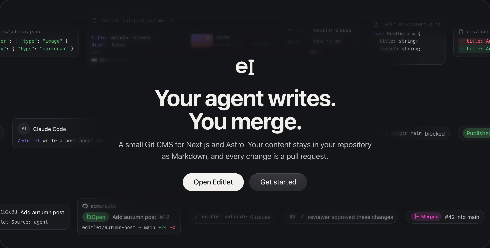

<p align="center">
  
</p>

<h1 align="center">Editlet</h1>

<p align="center"><strong>Your agent writes. You merge.</strong><br>A small Git CMS for Next.js and Astro, with a skill for your coding agent.</p>

<p align="center">
  <a href="https://editlet.gunkin.dev/docs/introduction"><strong>Docs</strong></a> ·
  <a href="https://editlet.gunkin.dev/?editlet">Live demo</a> ·
  <a href="#try-it-with-your-coding-agent">Get started</a> ·
  <a href="#ai-coding-agents">AI agents</a>
</p>

<p align="center">
  <a href="https://www.npmjs.com/package/editlet"></a>
  <a href="https://editlet.gunkin.dev/docs/quick-start-next"></a>
  <a href="https://editlet.gunkin.dev/docs/content-model"></a>
  <a href="LICENSE"></a>
</p>

Editlet keeps your content in your repository as Markdown with YAML frontmatter, described by one `cms/schema.json`.
Your coding agent edits it with the bundled skill, your team edits it with `?editlet` on any page of the site, and
every change is a pull request that a person merges.

> Early alpha: APIs may change between versions. Tested with Claude Code on Next.js and Astro.

<p align="center">
  <a href="https://editlet.gunkin.dev"></a>
</p>

## Try it with your coding agent

Paste this into Claude Code, Codex or another coding agent in your Next.js or Astro project:

```text
Install Editlet in this project: add the package `editlet` with the project's package manager, then read
node_modules/editlet/skills/editlet-setup/SKILL.md and follow it.
```

1. **Describe your content.** The agent writes `cms/schema.json` from your pages and wires the framework adapter.
2. **Edit.** Ask the agent (`/editlet write a post about…`), or open `?editlet` on any page and edit next to the live
   preview.
3. **Merge.** Every edit is a commit on an `editlet/<name>` branch with a pull request. Nothing goes live until a
   person merges it; the guard hook stops an agent from pushing to the base branch.

## Install

```bash
npm install editlet
node node_modules/editlet/skills/editlet/scripts/link.mjs --hooks
```

`link.mjs --hooks` links the skills into `.claude/skills/` and `.agents/skills/` and adds the guard hook. Run it again
any time; with `--check --hooks` it only reports. Then add `cms/schema.json` and wire the framework as shown below.

`next`, `react` and `astro` are optional peer dependencies. Install the ones your framework needs: `next >=16` with
`react >=19`, or `astro ^6 || ^7`. Node 22.12 or newer.

## Next.js

```ts
// next.config.ts
import { withEditlet } from 'editlet/next/config';
export default withEditlet({ reactStrictMode: true });
```

```ts
// src/lib/cms.ts
import { createReader } from 'editlet/next';
import type { EntryMap } from '../../.editlet/content';
export const { getEntries, getEntry, getRef } = createReader<EntryMap>();
```

```tsx
// app/layout.tsx: render <EditletLoader /> after {children}
import { EditletLoader } from 'editlet/next';
```

Add `/.editlet/` and `/public/editlet/` to `.gitignore`. Full guide:
[Quick start: Next.js](https://editlet.gunkin.dev/docs/quick-start-next).

## Astro

```js
// astro.config.mjs
import editlet from 'editlet/astro';
import { defineConfig } from 'astro/config';
export default defineConfig({ integrations: [editlet()] });
```

```ts
// src/content.config.ts
import { editletCollections } from 'editlet/astro/content';
export const collections = editletCollections();
```

Then use `getCollection`, `getEntry` and `render` as usual. Full guide:
[Quick start: Astro](https://editlet.gunkin.dev/docs/quick-start-astro).

## AI coding agents

The package ships three Agent Skills in `skills/`, matching the installed version. Knowledge is delivered as files, so
there is no MCP server to run.

| Skill | Use |
|---|---|
| `editlet` | Edit content and the schema, preview in `?editlet`, publish through an `editlet/<name>` branch and a PR |
| `editlet-setup` | Install Editlet in Next.js or Astro, set up editing on the live site, upgrade, diagnose (`doctor.mjs`) |
| `editlet-migrate` | Import Markdown/MDX folders, Astro collections, Decap, TinaCMS, Keystatic and similar |

Check content with `node node_modules/editlet/skills/editlet/scripts/validate.mjs`. Full guide:
[The agent skills](https://editlet.gunkin.dev/docs/agent-skills).

## Entry points

| Import | What it is |
|---|---|
| `editlet/next` | `createReader`, `EditletLoader` for Next.js Server Components |
| `editlet/next/config` | `withEditlet` wrapper for `next.config.ts` |
| `editlet/next/preview` | Draft-mode preview route (`POST`/`DELETE`) for `app/api/editlet/preview/route.ts` |
| `editlet/astro` | Astro integration |
| `editlet/astro/content` | `editletCollections`, `editletLoader` for `src/content.config.ts` |
| `editlet/core` | Schema, entry parsing, validation, type generation (no Node or framework APIs) |
| `editlet/node` | Local project reading and the dev file API |
| `editlet/github` | GitHub content source: tree reads, commits, branches, PRs |
| `editlet/auth` | GitHub OAuth handler (Cloudflare, Vercel, Node) |
| `editlet/auth/client` | Browser side of the sign-in flow |
| `editlet/auth/protocol` | Shared auth constants and types |
| `editlet/loader` | The `?editlet` loader that mounts the editor iframe on a page |
| `editlet/loader/protocol` | The `postMessage` protocol between page and admin |
| `editlet/admin/dist/*` | The prebuilt admin app (static files) |

Browsers: Chrome 125+, Edge 125+, Firefox 126+, Safari 17.5+.

Documentation: https://editlet.gunkin.dev/docs/introduction

## License

[MIT](LICENSE) © Anton Gunkin
