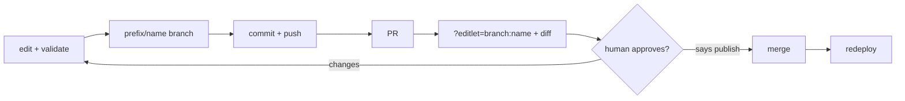

# Publishing (prod)

A change goes live when it is merged into the base branch. Hosting then rebuilds the site, which takes 1–3 minutes.
You work only with `git` and `gh` in the local clone, and the human decides when the merge happens.



## Before you start

- `gh auth status` must show a login. If it does not, ask the human to run `gh auth login` themselves. Never ask for a
  token.
- Base branch: `git.baseBranch` in `cms/schema.json` (below: `<base>`). Run `git fetch origin`.
- Run `validate`. Fix every issue first.
- **Take names from `style.mjs`, never write them by hand.** It applies `git` of the schema (branch prefix, commit
  template, pull request title, labels, draft) exactly as the editor does, so branches, commits and pull requests from
  you and from `?editlet` look the same. The prefix is `git.branchPrefix`, default `editlet/` (below: `<prefix>`).

```bash
S=.claude/skills/editlet/scripts/style.mjs
node $S branch spring sale post         # → editlet/spring-sale-post
node $S commit --staged                 # → the message for what is staged, with "Editlet-Source: agent"
node $S pr <branch> --login <you> [--site <url>] [--param <name>]   # → JSON { title, body, labels, draft }
```

## 1. Branch

One `<prefix><name>` branch holds one change set: everything the human will review and publish together. By default,
all edits made since the last publish in this conversation are one change set; start a new one when the human says so
or switches to an unrelated topic. `<name>` is a short slug of the intent: `node $S branch spring sale post` gives
`editlet/spring-sale-post`.

Edit in the working tree while the human iterates. Create the branch, commit, push and open the PR when they ask to
publish or to see a preview on the live site, not after every edit.

- **Same change set, continuing:** reuse its branch. Check with
  `gh pr list --head <branch> --state open --json number,url`, then `git switch <branch> && git pull --ff-only`.
- **New change set:** `git switch -c "$(node $S branch <name>)" --no-track origin/<base>`. Uncommitted edits come
  along. If
  `git switch` refuses because of a conflict, stop and ask.
- The human's unrelated uncommitted work stays uncommitted. You stage only your paths.

## 2. Commit and push

```bash
node .claude/skills/editlet/scripts/validate.mjs
git add cms/content/post/spring-sale.md cms/content/post/spring-sale/   # only your paths
git diff --cached --stat                                                  # nothing else staged?
node $S commit --staged > /tmp/editlet-msg                                # the style's message + trailer
git commit -F /tmp/editlet-msg -- cms/content/post/spring-sale.md cms/content/post/spring-sale/
git push -u origin <branch>
```

The guard hook blocks a commit while `validate` fails, blocks any push to `<base>`, and asks first when content is
committed on a branch outside `<prefix>`. If the guard denies a command, fix the cause. Never work around it.

The `Editlet-Source: agent` trailer and the prefix mark the change as Editlet's. They are a convention for people and
search, not a permission: GitHub's rulesets decide what may be pushed and merged.

## 3. Pull request

```bash
node $S pr <branch> --login "$(gh api user --jq .login)" --site <site> > /tmp/editlet-pr.json
gh pr create --base <base> --head <branch> \
  --title "$(jq -r .title /tmp/editlet-pr.json)" --body "$(jq -r .body /tmp/editlet-pr.json)" \
  $(jq -r '.labels[] | "--label " + .' /tmp/editlet-pr.json) $(jq -r 'if .draft then "--draft" else "" end' /tmp/editlet-pr.json)
```

The body lists the changed entries and the review link between `<!-- editlet:start -->` and `<!-- editlet:end -->`.
Anything outside the markers is the human's. `gh pr create --label` fails when a label does not exist in the repo:
then create the pull request without it and tell the human. Run `gh label create` only after an explicit yes.

If the branch already has a PR, do not open a second one. After the next push, refresh its body:

```bash
gh pr view <n> --json body -q .body | node $S pr-body <branch> --login <you> --site <site> | gh pr edit <n> --body-file -
```

## 4. Show the change

- In chat: a short per-entry summary, with `git diff origin/<base>...HEAD --stat` and the key field changes.
- In the browser: open `<site>/?editlet=branch:<name>`, where `<name>` has no `<prefix>`. A site with its own parameter
  name (`EDITLET_PARAM`, `admin.param`: see [preview](preview.md)) uses `?<param>=branch:<name>`; pass `--param <name>`
  to `pr` and `pr-body` so the review link in the body uses it too. The editor finds the branch
  preview deployment and shows the diff. While the preview build runs, it shows "build in progress" and the diff.
- Site URL: use the one the human gave you, or the latest production deployment:
  `gh api "repos/{owner}/{repo}/deployments?environment=Production&per_page=1" --jq '.[0].statuses_url'`, then
  `gh api <statuses_url> --jq '.[0].environment_url'`. If neither works, ask once.

Then stop and say: what changed, the PR link, the preview link, and that you will merge when they say so.

## 5. Approval and merge

Merge only when the human writes an explicit go-ahead in this conversation, after seeing this PR: "publish", "merge
it", "ship it", "go live". "Looks good" alone is not enough. Ask once: "Merge PR #12 into main now?"

To merge:

```bash
gh pr view <n> --json mergeable,mergeStateStatus,url
gh repo view --json squashMergeAllowed,mergeCommitAllowed,rebaseMergeAllowed
gh pr merge <n> --squash --delete-branch      # or --merge / --rebase, whichever the repo allows
```

The guard hook turns `gh pr merge` into a permission prompt, so the human confirms once more.

**Blocked merges.** If the base branch needs reviews or checks, or the merge fails, give the PR link and what blocks
it, then stop. Use `gh pr merge <n> --auto` only if the human asks; it waits for the checks and keeps protection.
NEVER pass `--admin`, push to `<base>`, or change branch protection.

## 6. After the merge

- Tell the human that hosting is rebuilding (1–3 minutes). For status:
  `gh api "repos/{owner}/{repo}/deployments?ref=<base>&per_page=1"`.
- Return to the base: `git switch <base> && git pull --ff-only`.

## Undo a published change

Use a new change set, never a direct push:

```bash
git switch -c "$(node $S branch revert spring sale)" --no-track origin/<base>
git revert --no-edit <squash-commit>          # a merge commit needs: git revert --no-edit -m 1 <merge-commit>
node .claude/skills/editlet/scripts/validate.mjs
```

Then push, open a PR, show it, and merge after approval, the same as steps 2–5.

## Closing without publishing

If the human drops the change: `gh pr close <n> --delete-branch`, after they confirm. The content on `<base>` stays
as it was.
